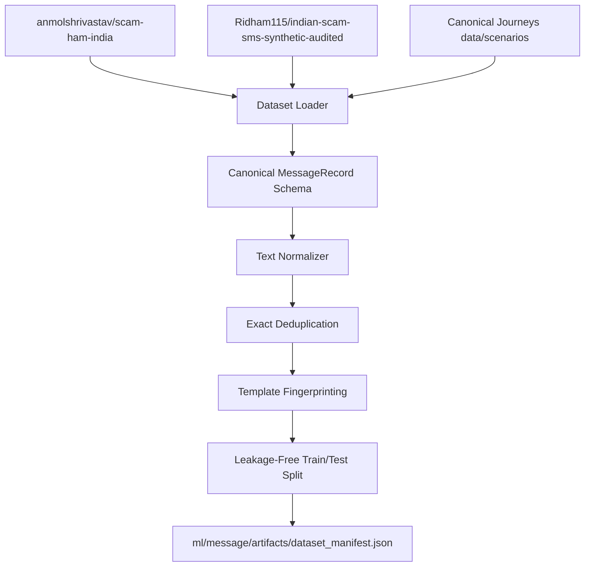

# ScamGraph AI Dataset Registry

## 1. Overview
The ScamGraph AI Dataset Registry tracks and manages all training, evaluation, benchmark, and synthetic datasets utilized across ScamGraph AI detection layers.

Every dataset entered into the system is cataloged in `data/registry/datasets.yaml` and subject to strict governance rules:
- **No silent mixing**: Real, synthetic, and mixed datasets must be explicitly flagged via `is_synthetic` and `real_or_synthetic`.
- **Deduplication**: Exact duplicates are stripped using normalized string hashing.
- **Leakage-free splitting**: Records are partitioned into `train` and `test` splits based on campaign ID and template fingerprinting, preventing template parameterization bleed.

---

## 2. Registered Datasets

### A. Scam/Ham India Dataset (`scam-ham-india`)
- **Source**: Hugging Face (`anmolshrivastav/scam-ham-india`)
- **License**: Apache 2.0
- **Format**: CSV (`scam_hum_india.csv`)
- **Volume**: 2,272 messages (1,377 Ham, 895 Spam/Scam)
- **Nature**: Mixed (Real + Synthetic)
- **Scope**: Indian SMS scam terminology covering Bank KYC, OTP theft, Aadhaar/PAN linking, fake jobs, electricity bills, and lottery lures.
- **Limitations**: English-only text; contains template redundancy.

### B. Indian Scam SMS Synthetic Audited (`indian-scam-sms-synthetic-audited`)
- **Source**: Hugging Face (`Ridham115/indian-scam-sms-synthetic-audited`)
- **License**: MIT
- **Format**: CSV (`data/synthetic_audited.csv`)
- **Volume**: 1,580 messages (797 Scam, 783 Safe)
- **Nature**: Synthetic (Human-audited)
- **Scope**: Multilingual and code-mixed Indian regional SMS messages:
  - Hinglish (639)
  - English (262)
  - Hindi (167)
  - Bengali-English / bn_en (135)
  - Marathi-English / mr_en (127)
  - Tamil-English / ta_en (125)
  - Telugu-English / te_en (125)
- **Scam Types Covered**: Electricity bill, loan offers, fake bank OTP, lottery lures, courier/customs, job offers, KYC phishing.
- **Audit Actions**: `unreviewed` (1350), `keep` (195), `flip` (35).

### C. ScamGraph Canonical Fraud Journey Scenarios (`scamgraph-canonical-journeys`)
- **Source**: Internal repository (`data/scenarios/*.json`)
- **License**: Proprietary / Internal Benchmark
- **Format**: JSON
- **Nature**: Synthetic (Expert-curated multi-stage journey progressions)
- **Scope**: 5 canonical fraud scenarios (KYC Bank Impersonation, Electricity Disconnection, Fake Job/Part-time, Fake Courier Customs, Legitimate Utility Baseline).
- **Use**: Journey progression validation, cross-channel timeline correlation, and integration testing.

---

## 3. Data Ingestion & Preprocessing Pipeline

Located at `ml/message/`:
- `dataset_loader.py`: Downloads or reads cached CSV/JSON assets without depending on Python `dill` serialization.
- `preprocessor.py`: Normalizes text, performs exact deduplication, computes template fingerprints (masking amounts, phone numbers, and URLs), and deterministically partitions into train/test groups.

