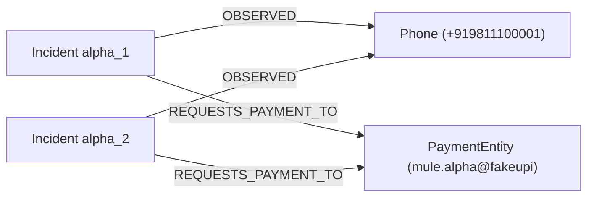

# ScamGraph AI Graph Analytics (Step 24)

## 1. Overview & Strategy

ScamGraph AI Graph Analytics turns the Neo4j Evidence Graph into an explainable relationship and correlation intelligence layer.

Following our design principles:
- **Deterministic Analytics First**: We utilize Weakly Connected Components (WCC), Node Neighborhood Similarity, and modularity/Louvain community detection.
- **Explainability**: Every graph finding retains full relationship paths (e.g. `Incident A -> OBSERVED Phone1 <- OBSERVED Incident B`). We never return a similarity score in isolation.
- **Topological vs. Fraud Distinction**: Graph similarity measures structural neighborhood overlap between incidents. **It is NOT a calibrated fraud probability.**
- **No GNN Dependency**: Graph Neural Networks remain a stretch experiment; production analytics rely on deterministic graph algorithms supported by Neo4j Graph Data Science (GDS).

---

## 2. Core Graph Analytics Algorithms

### A. Weakly Connected Components (WCC)
- **Objective**: Partitions the incident-entity bipartite graph into disjoint connected components based on shared indicators: `Phone`, `Domain`, `IP`, `Nameserver`, `Certificate`, and `PaymentEntity`.
- **Use Case**: Separates isolated incidents from large multi-victim coordinated campaigns.
- **Output**:
  - `component_id`: Unique identifier (e.g. `comp_0`, `comp_1`)
  - `incident_ids`: All incidents belonging to this connected component
  - `shared_entities`: Entities linking 2 or more incidents in the component
  - `size`: Total number of incidents

### B. Bipartite Node Neighborhood Similarity
- **Objective**: Compares the entity neighborhoods of two incidents to measure structural overlap.
- **Metrics Supported**:
  - **Jaccard**: $\frac{|N(A) \cap N(B)|}{|N(A) \cup N(B)|}$
  - **Overlap**: $\frac{|N(A) \cap N(B)|}{\min(|N(A)|, |N(B)|)}$
  - **Cosine**: $\frac{|N(A) \cap N(B)|}{\sqrt{|N(A)| \cdot |N(B)|}}$
- **Application**: Discovers related incidents even when specific identifiers change (e.g., matching common hosting infrastructure or shared payment mules).

### C. Candidate Campaign Community Detection
- **Objective**: Identifies cohesive subgraphs representing coordinated criminal operations.
- **Terminology Rule**: Surfaces **Candidate Campaign Communities**, *never* unverified "confirmed scam campaigns".
- **Algorithm**: Louvain / modularity clustering identifying densely interconnected incident clusters sharing common infrastructure and payment entities.

### D. High-Value Hub Entity Discovery
- **Objective**: Ranks graph entities by degree centrality and incident sharing count.
- **Discovered Entity Types**:
  - **Mule Payment Entities**: VPAs and bank accounts receiving funds across multiple independent victims.
  - **Bulletproof Nameservers**: Nameservers hosting clusters of typosquatting/phishing domains.
  - **Syndicate Phone Numbers**: Telecom identifiers contacting multiple victims across SMS and WhatsApp.

---

## 3. Explainable Path Traversal

Every correlation finding provides an exact traversal path linking the incidents:



**Human-Readable Audit Output:**
```text
Incident alpha_1 -> OBSERVED Phone (+919811100001) <- OBSERVED Incident alpha_2
Incident alpha_1 -> OBSERVED PaymentEntity (mule.alpha@fakeupi) <- OBSERVED Incident alpha_2
```

---

## 4. Structured Output: `GraphCorrelationResult`

The primary output contract of `GraphAnalyticsService.correlate_incident()`:

```json
{
  "related_incident_id": "alpha_2",
  "graph_similarity": 0.6667,
  "shared_entities": [
    {
      "entity_type": "Phone",
      "entity_id": "+919811100001",
      "display_value": "+919811100001"
    },
    {
      "entity_type": "PaymentEntity",
      "entity_id": "mule.alpha@fakeupi",
      "display_value": "mule.alpha@fakeupi"
    }
  ],
  "relationship_paths": [
    "Incident alpha_1 -> OBSERVED Phone (+919811100001) <- OBSERVED Incident alpha_2",
    "Incident alpha_1 -> OBSERVED PaymentEntity (mule.alpha@fakeupi) <- OBSERVED Incident alpha_2"
  ],
  "community_id": "campaign_community_1",
  "evidence_ids": [],
  "explanation": "Topological link discovered: alpha_1 ↔ alpha_2 with Jaccard similarity 0.667. Shared entities: +919811100001, mule.alpha@fakeupi."
}
```

---

## 5. Synthetic Validation (13-Incident Benchmark)

Tested in `tests/unit/test_graph_analytics_step24.py`:
- **Campaign Alpha** (5 incidents): Cohesive KYC ring sharing phone `+919811100001` and VPA `mule.alpha@fakeupi`. Correctly grouped into a single connected component of size 5 and community `campaign_community_1`.
- **Campaign Beta** (4 incidents): Job scam ring sharing domain `beta-job.example` and VPA `job.hr@fakeupi`. Correctly grouped into a separate component of size 4 and community `campaign_community_2`.
- **Unrelated Benign Group** (4 incidents): Legitimate transactions across distinct merchants. Correctly classified as isolated components of size 1 with 0.0 similarity to the scam rings.
