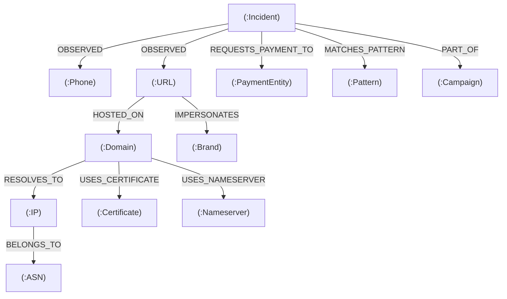
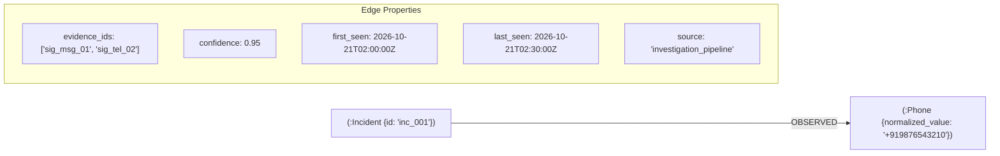

# ScamGraph AI Graph Intelligence (Step 23)

## 1. Architectural Role & Responsibilities

ScamGraph AI separates transactional storage from topological graph intelligence:

| Responsibility | Storage Layer | Scope |
| :--- | :--- | :--- |
| **Transactional Records** | PostgreSQL | Incidents, chronological events, raw evidence payloads, model scores, and intervention decisions. |
| **Semantic Embeddings** | PostgreSQL (pgvector) | 384/1024-dim dense message embeddings for HNSW cosine similarity search. |
| **Topological Intelligence** | Neo4j Graph Database | Multi-incident entity correlation, shared infrastructure, payment networks, and campaign clusters. |

> [!IMPORTANT]
> Neo4j does not store raw application rows. It models relationships that connect separate incidents through shared infrastructure, identifiers, payment entities, and tactics.

---

## 2. Graph Schema & Relationship Topology



---

## 3. Node Types

1. **`(:Incident)`**: Represents a fraud case (properties: `id`, `channel`, `status`, `created_at`, `risk_score`).
2. **`(:Phone)`**: Originating or recipient phone number (normalized to E.164 format, e.g. `+919876543210`).
3. **`(:URL)`**: Web endpoint or phishing landing page (normalized without fragments and sorted query params).
4. **`(:Domain)`**: Fully-qualified domain name (lowercase, stripped of ports, `www.` prefix, and trailing dots).
5. **`(:IP)`**: Host IPv4 or IPv6 address.
6. **`(:ASN)`**: Autonomous System Number (e.g. `AS13335`).
7. **`(:Brand)`**: Legitimate entity impersonated by the fraudster (e.g. `SBI`, `HDFC`, `DISCOM`).
8. **`(:PaymentEntity)`**: Mule UPI ID/VPA, bank account, or digital wallet (e.g. `scammer@fakeupi`).
9. **`(:Certificate)`**: SSL/TLS certificate SHA256/SHA1 fingerprint.
10. **`(:Nameserver)`**: Authoritative DNS nameserver host.
11. **`(:Pattern)`**: Recognized fraud tactic or journey template (e.g. `KYC_IMPERSONATION`).
12. **`(:Campaign)`**: Clustered scam operation linking multiple correlated incidents.

---

## 4. Relationship Provenance

Strict Rule: **Never create unexplained graph relationships.**

Every edge connecting an incident to an entity or linking infrastructure components maintains full audit provenance:



---

## 5. Non-Destructive Entity Normalization

Implemented in `services/graph-engine/normalization/entity_normalizer.py`:

Every entity retains:
- **`normalized_value`**: Deterministic lowercase, stripped, and canonicalized value used as the unique graph identifier.
- **`display_value`**: The exact original string preserved for UI presentation, analyst review, and legal evidence.

### Normalization Rules

| Entity | Raw Variant Examples | `normalized_value` | `display_value` |
| :--- | :--- | :--- | :--- |
| **Domain** | `HTTPS://Example.COM/login`, `www.example.com:443` | `example.com` | `HTTPS://Example.COM/login` |
| **URL** | `https://example.com/login/`, `https://example.com/login#section` | `https://example.com/login` | Original URL string |
| **Phone** | `09876543210`, `+91 98765-43210`, `9876543210` | `+919876543210` | Original phone input |
| **Payment (UPI)** | `ABC@upi`, `abc@upi`, `John.Doe@okaxis ` | `abc@upi`, `john.doe@okaxis` | Original handle |
| **Bank Account** | `1234 5678 9012`, `1234-5678-9012` | `123456789012` | Original input |
| **IP Address** | `192.168.1.1 ` | `192.168.1.1` | `192.168.1.1` |
| **ASN** | `13335`, `as 13335`, `AS13335` | `AS13335` | Original input |

---

## 6. Uniqueness & Idempotency

Cypher constraints ensure uniqueness across all nodes:
```cypher
CREATE CONSTRAINT incident_id_unique IF NOT EXISTS FOR (i:Incident) REQUIRE i.id IS UNIQUE;
CREATE CONSTRAINT domain_norm_unique IF NOT EXISTS FOR (d:Domain) REQUIRE d.normalized_value IS UNIQUE;
CREATE CONSTRAINT phone_norm_unique IF NOT EXISTS FOR (p:Phone) REQUIRE p.normalized_value IS UNIQUE;
CREATE CONSTRAINT payment_norm_unique IF NOT EXISTS FOR (pe:PaymentEntity) REQUIRE pe.normalized_value IS UNIQUE;
CREATE CONSTRAINT url_norm_unique IF NOT EXISTS FOR (u:URL) REQUIRE u.normalized_value IS UNIQUE;
CREATE CONSTRAINT ip_norm_unique IF NOT EXISTS FOR (ip:IP) REQUIRE ip.normalized_value IS UNIQUE;
```

All synchronization operations utilize Cypher `MERGE` with `ON CREATE SET` and `ON MATCH SET`. Synchronizing the same incident telemetry multiple times produces zero duplicate nodes or relationships.

---

## 7. Fault Tolerance & Graceful Degradation

If the Neo4j instance is offline or unreachable:
1. `GraphSyncService` catches the network timeout without raising an uncaught exception.
2. Returns a structured `GraphSyncResult`:
   ```json
   {
     "status": "UNAVAILABLE",
     "incident_id": "inc_123",
     "nodes_synced": 0,
     "relationships_synced": 0,
     "error": "Neo4j connection unavailable"
   }
   ```
3. PostgreSQL, Pattern Engine, URL Analyzer, TinyFish, and Risk Engine continue uninterrupted. The Incident Assessment successfully completes with graph enrichment noted as `UNAVAILABLE`.
