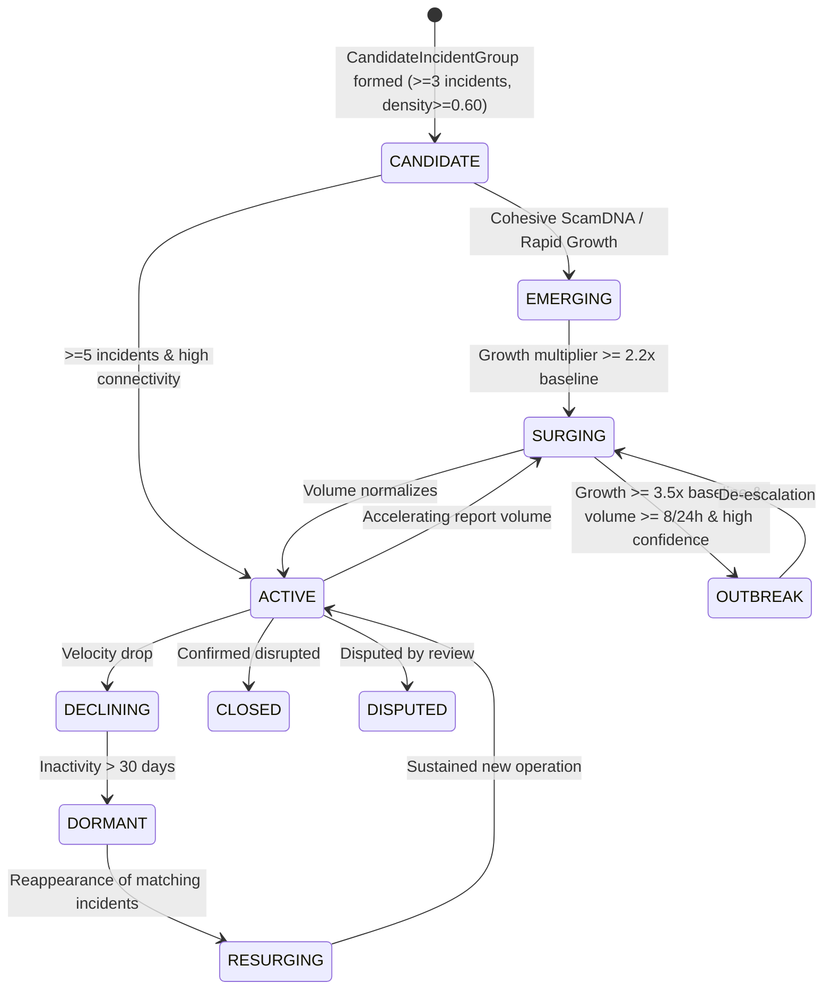

# Campaign Lifecycle & Mutation Dynamics

## Lifecycle State Machine

### Transition Invariants
- **No Direct Jump from Candidate to Outbreak**: An emerging group must pass intermediate thresholds to avoid knee-jerk false positives.
- **Resurgence Lineage**: When dormant campaigns revive (e.g. after 60+ days), previous campaign history, infrastructure, and DNA profiles are preserved rather than creating disconnected fragments.
- **Auditable Merges and Splits**: Merges and splits generate formal `CampaignMergeSplitProposal` artifacts requiring analyst review rather than silent destructive modifications.

---

## Infrastructure Drift & Mutation Tracking

Scam operators regularly rotate disposable contact details while retaining core playbook DNA:
1. **Payment Rotation**: Tracked when new UPI VPAs or mule accounts receive money while journey and tactics match.
2. **Phone & Domain Rotation**: Tracked when robocalls switch caller IDs or typosquat domains rotate.
3. **Channel Migration**: Tracked when bait moves across platforms (e.g., WhatsApp $\to$ Telegram VIP groups).
4. **Tactic Drift**: Evolution from initial greed/reward lures into urgent fear/blackmail escalations.
