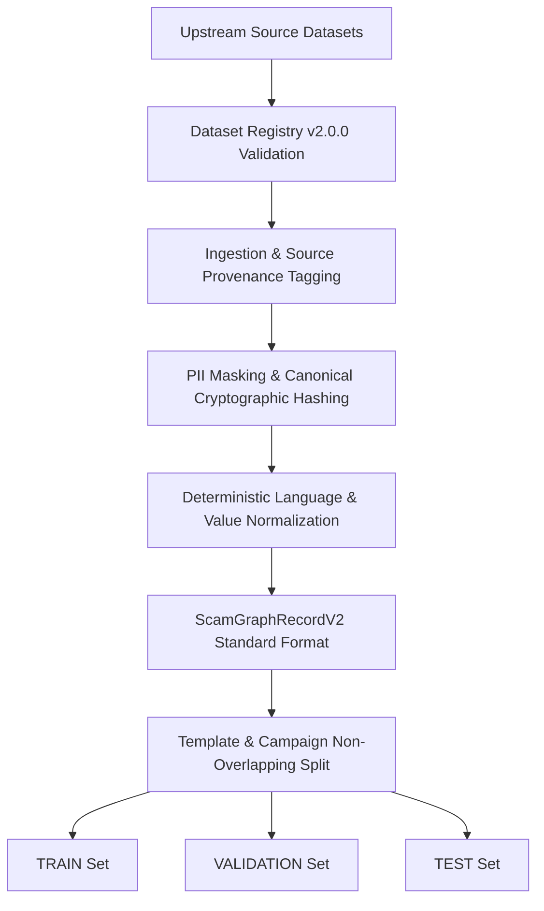

# Data Governance & Dataset Lineage Policy
**Phase 0B: Dataset Registry V2**  
**Date:** October 24, 2026

---

## 1. Truth in Provenance

Prior to Phase 0B, dataset provenance was reduced to a binary `is_synthetic: true/false`. This created severe evaluation risks: mixed datasets (such as `scam-ham-india`) were flagged as `is_synthetic: false`, creating the illusion of 100% real human ground truth.

ScamGraph AI V2 enforces granular provenance typing:
- **`REAL_VERIFIED`**: Certified real user incident / telecom capture.
- **`REAL_ANONYMIZED`**: Real incident sanitized of PII.
- **`PUBLIC_REAL`**: Sourced from public repository of real incidents.
- **`PUBLIC_MIXED`**: Public dataset containing an unvetted blend of real and synthetic samples.
- **`HUMAN_CURATED`**: Hand-crafted scenarios designed by fraud analysts.
- **`SYNTHETIC_LLM`**: Generated via Large Language Model prompting.
- **`SYNTHETIC_TEMPLATE`**: Generated via rule/regex templates.
- **`SYNTHETIC_OTHER`**: Other programmatic generation.
- **`WEAK_LABEL`**: Heuristically or regex-labelled data.

---

## 2. Ingestion & Preprocessing Pipeline

---

## 3. Strict Gold Set Rules

1. **Synthetic Data Prohibition**: Synthetic data (`SYNTHETIC_LLM`, `SYNTHETIC_TEMPLATE`) cannot be approved as independent Gold Set data (`gold_set_approved=True` is prohibited by automated registry validator).
2. **Zero Contamination**: Records in `data/gold/` must NEVER be exposed to training scripts, data augmentation pipelines, or prompt examples.
3. **Weak Label Separation**: Heuristic scam-family predictions (e.g. `_infer_scam_type_from_text`) are explicitly recorded with `annotation_type=AnnotationType.RULE_INFERRED` and cannot masquerade as human-verified ground truth.
