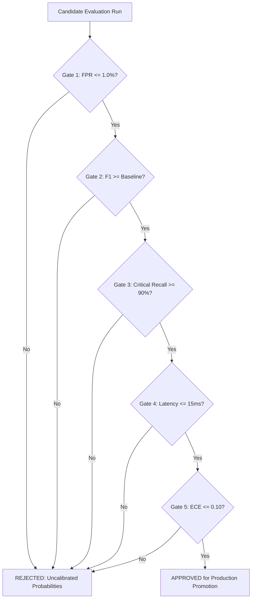

# Model Promotion & Regression Gating Policy
**Phase 0C: Governance Policy**  
**Date:** October 24, 2026

---

## 1. Why Accuracy Alone is Insufficient

In scam intelligence, a model cannot be promoted solely because its accuracy increased. A model that achieves 98% accuracy by labeling all banking alerts as scams destroys consumer trust and causes alert fatigue.

---

## 2. Mandatory Promotion Gates

To replace an active `BASELINE` model, a `CANDIDATE` model must satisfy all five gates on the independent benchmark:

| Gate | Requirement | Threshold / Tolerance |
| :--- | :--- | :--- |
| **Gate 1: FPR Ceiling** | False Positive Rate on verified legitimate and hard-negative notifications | **FPR ≤ 1.0%** |
| **Gate 2: Macro F1 Retention** | Overall Macro F1 on unseen templates | **F1 ≥ Baseline F1** |
| **Gate 3: Critical Family Recall** | Recall on high-severity families (Digital Arrest, KYC block) | **Recall ≥ 90.0%** |
| **Gate 4: Latency & Throughput** | Mean inference latency under load | **Latency ≤ 15.0 ms** on CPU |
| **Gate 5: Calibration Check** | Expected Calibration Error | **ECE ≤ 0.10** |

---

## 3. Promotion Decision Matrix

