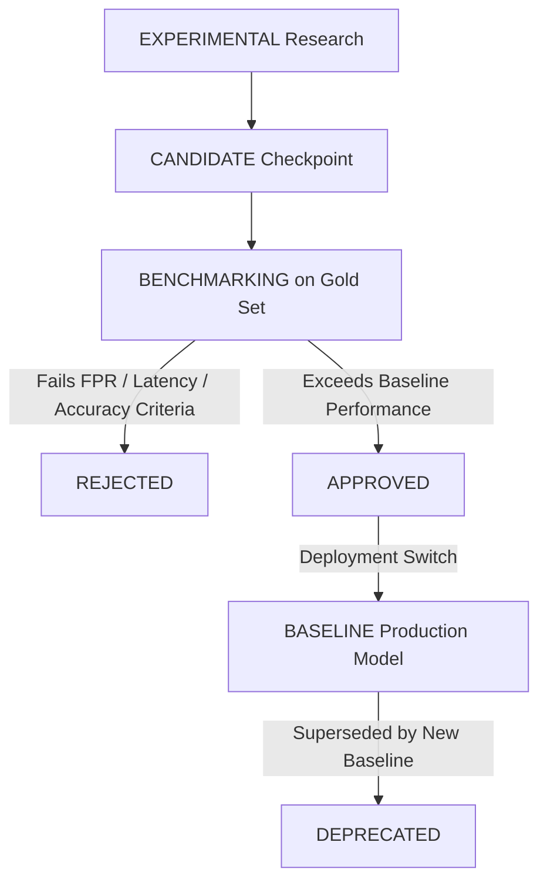

# Model Governance & Lifecycle Policy
**Phase 0B: Model Registry V1**  
**Date:** October 24, 2026

---

## 1. Model Lifecycle States

Every model evaluated or integrated into ScamGraph AI must be registered in `data/registry/models.yaml` (v1.0.0) with an explicit governance status:

| Status | Definition & Operational Guidelines |
| :--- | :--- |
| **`BASELINE`** | The active production or staging model serving live traffic or baseline benchmarking. |
| **`CANDIDATE`** | A trained model or fine-tuned checkpoint submitted for evaluation against the gold benchmark. |
| **`BENCHMARKING`**| Actively undergoing offline leakage-free benchmark evaluation. |
| **`APPROVED`** | Verified to outperform the current baseline across accuracy, latency, and false-positive criteria without regression. Ready for production promotion. |
| **`EXPERIMENTAL`** | Early-stage research prototype, heuristic rule set, or architectural trial. Not approved for autonomous decisioning. |
| **`REJECTED`** | Formally rejected due to unacceptable performance, high false-positive rate, latency issues, or excessive compute demands. |
| **`DEPRECATED`** | Previously active model retained only for backward-compatibility or legacy playback. |

---

## 2. Model Promotion Pipeline

---

## 3. Currently Registered Models

1. **`scamgraph-message-baseline`**: `BASELINE` (TF-IDF + Logistic Regression, 95.6% accuracy, 3.9% FPR, <5ms CPU latency).
2. **`distilbert-scam-detector-india`**: `REJECTED` (High false-alarm rate on Indian transactional SMS alerts).
3. **`multilingual-e5-small`**: `BASELINE` (Default 384-dim CPU-friendly sentence embedding encoder).
4. **`bge-m3`**: `CANDIDATE` (1024-dim high-dimensional candidate for long-context cross-channel journey embeddings).
5. **`paraphrase-multilingual-minilm-l12-v2`**: `DEPRECATED` (Legacy prototype encoder retained for backward compatibility).
6. **`url-risk-heuristic`**: `BASELINE` (Heuristic feature-weighted URL scorer; truthfully relabeled from "ML").
7. **`payment-risk-heuristic`**: `BASELINE` (Rule-based VPA mismatch scorer; truthfully relabeled from "ML").
