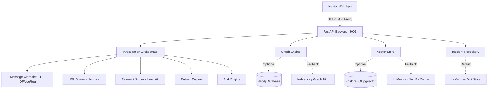
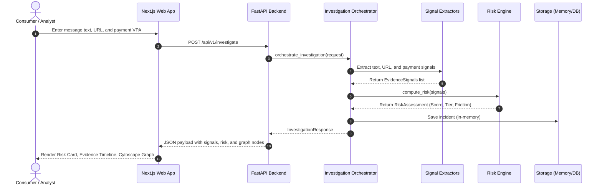

# ScamGraph AI — Repository Architecture Map & Data Flow
**Phase 0A: Baseline Audit Artifact**  
**Date:** October 24, 2026

---

## 1. High-Level Directory Tree

```
ScamGraph-ai/
├── apps/
│   └── web/                   # Next.js 14 App Router frontend
│       ├── app/               # Routes: /, /investigate, /lab, /incidents, /campaigns, /graph, /registry, /mulehunter
│       │   └── api/v1/        # Proxy API route handlers forwarding to FastAPI backend
│       ├── components/        # UI components (graph, timeline, evidence, shell, cards)
│       └── lib/               # Utility functions, API clients, hooks
├── services/
│   ├── api/                   # FastAPI main backend service (Port 8001)
│   │   └── app/               # Endpoints, domain logic, repositories, routers
│   ├── graph-engine/          # Neo4j repository, Cypher queries, in-memory graph fallback
│   ├── investigation/         # Orchestrator for URL/DNS/TinyFish/message investigation
│   ├── pattern-engine/        # Pattern matching, YAML scam definitions, heuristic rules
│   ├── risk_engine/           # Unified risk assessment scoring logic
│   ├── registry/              # Scam indicator registry & fingerprinting
│   ├── simulation/            # Interactive scenario simulation engine
│   ├── storage/               # In-memory and pgvector vector storage interfaces
│   └── mule_engine/           # Mule account detection rules and models
├── packages/
│   └── schemas/               # Shared Pydantic data models (Signals, Entities, Incidents)
├── ml/
│   ├── message/               # TF-IDF + Logistic Regression NLP scam classifier & artifacts
│   ├── url/                   # Heuristic URL risk classifier
│   ├── payment/               # Heuristic UPI payment risk classifier
│   └── embeddings/            # SentenceTransformer embeddings interface & cache
├── data/
│   ├── patterns/              # YAML pattern definitions (KYC, digital arrest, job scam, etc.)
│   ├── scenarios/             # Canonical multi-stage fraud scenarios
│   └── registry/              # datasets.yaml metadata registry
├── infrastructure/
│   ├── postgres/              # init.sql (pgvector & uuid-ossp extensions)
│   └── neo4j/                 # Docker/Neo4j configuration
└── tests/
    ├── unit/                  # Unit tests for components and ML
    ├── integration/           # Integration tests
    └── scenarios/             # End-to-end scenario evaluations
```

---

## 2. Component Dependency Graph



---

## 3. Current Data Flow (Investigation Request)



---

## 4. Current Persistence Architecture

| Domain Entity | Primary Storage Class | Fallback Mechanism | Durability |
| :--- | :--- | :--- | :--- |
| **Incidents** | `services.api.app.repository.memory.MemoryIncidentRepository` | In-memory Python `dict` | **None** (Lost on restart) |
| **Vector Embeddings** | `services.storage.vector.pgvector_store.PgVectorStore` | `InMemoryVectorStore` | **Volatile** |
| **Entities & Graph** | `services.graph_engine.neo4j.repository.GraphRepository` | In-memory adjacency list | **Volatile** |
| **Registry Entries** | `services.registry.repository.InMemoryRegistryRepository` | In-memory Python `dict` | **None** |
| **Pattern Taxonomy** | Filesystem YAML (`data/patterns/*.yaml`) | Static files | **Persistent** |
| **ML Artifacts** | Filesystem Joblib (`ml/message/artifacts/*.joblib`) | Static files | **Persistent** |
