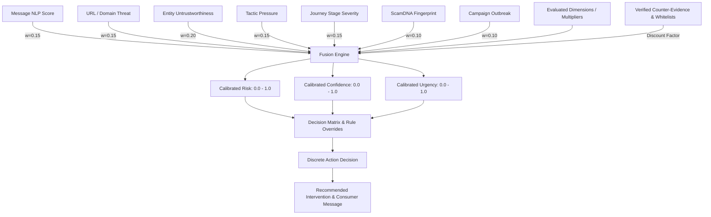

# SCAMGRAPH AI — UNIFIED DECISION ENGINE (PHASE 4A)
## Single Coherent Decision Layer Across All Subsystem Signals

### 1. Executive Overview

Prior to Phase 4A, ScamGraph operated specialized analytical engines:
- **Message NLP / Semantic Classifiers** (Text manipulation, spam, intent)
- **URL & Domain Intelligence** (Phishing indicators, domain age, typosquatting)
- **Entity Intelligence V2 & Trust Models** (Phone, UPI VPA, Bank, Telegram, Domain entity resolution)
- **Tactic & Social Engineering Engine** (Fear, urgency, authority, isolation tactics)
- **Scam Journey Engine V1** (Temporal progression, stage inference, pre-loss escalation)
- **ScamDNA V3** (Structural, linguistic, and behavioral vector fingerprints)
- **Campaign Intelligence & Outbreak Radar** (Cluster correlation, outbreak status, multi-victim lineage)

While each engine generated accurate sub-scores, displaying disconnected numbers risked confusing consumers and paralyzing banking fraud analysts.

**Phase 4A introduces the Unified Decision Layer (`services/decision_engine/`)**, fusing all signals into an authoritative, calibrated **Tripartite Decision**:
1. **Risk Score & Band** ($R \in [0.0, 1.0]$): Likelihood of fraudulent intent and potential victim harm.
2. **Confidence Score & Band** ($C \in [0.0, 1.0]$): Depth, consistency, and corroboration of observable evidence.
3. **Urgency Score & Band** ($U \in [0.0, 1.0]$): Immediacy of irreversible action (payment transfer, credential surrender).
4. **Action-Ready Disposition**: A definitive operational directive chosen from 7 discrete actions (`ALLOW`, `EDUCATE`, `VERIFY_INDEPENDENTLY`, `WARN`, `STRONG_WARNING`, `DELAY_PAYMENT`, `BLOCK_PRE_LOSS`).

---

### 2. Multi-Signal Fusion Architecture

#### Core Mathematical Formulae:

1. **Active Weight Normalization**:
   $$W_{\text{active}} = \sum_{d \in D_{\text{evaluated}}} w_d$$
   $$R_{\text{raw}} = \frac{1}{W_{\text{active}}} \sum_{d \in D_{\text{evaluated}}} w_d \cdot s_d$$
   This prevents score dilution when an incident only provides a subset of observables (e.g., SMS text without a URL).

2. **Counter-Evidence Discounting**:
   If official, verified institutional channels are present (e.g., trusted `.gov.in`, official bank SMS shortcodes, verified VPAs):
   $$R_{\text{discounted}} = R_{\text{raw}} \times (1.0 - \text{counter\_evidence\_factor})$$

3. **Campaign Outbreak Floor**:
   If matching an active campaign cluster with status `OUTBREAK`:
   $$R = \max(R_{\text{discounted}}, 0.85)$$
   $$C = \max(C, 0.85)$$
   $$U = \max(U, 0.75)$$

---

### 3. Separation of Consumer vs. Analyst Payloads

The Decision Layer enforces strict boundary separation:
- **Consumer Facing**:
  - `action`: Human-readable directive (e.g. "Do Not Transfer Money", "Verify Independently").
  - `consumer_headline` & `consumer_message`: Plain, empathetic, non-technical guidance without raw ML floats or graph node IDs.
  - `suggested_cooling_off_minutes`: Explicit time delay (e.g. 120 minutes) to break psychological manipulation.
  - `safeguard_steps`: 3-5 concrete steps (e.g., call 1930, verify via official bank branch).
- **Analyst & Partner Facing**:
  - Exact `risk_score`, `confidence_score`, `urgency_score` with corresponding `TripartiteBand` (`VERY_LOW`, `LOW`, `MODERATE`, `HIGH`, `CRITICAL`).
  - Full breakdown of `dimension_contributions` showing raw input, configured weight, effective contribution, and whether discounted.
  - `corroboration_factor` and missing dimension `uncertainty_penalty`.
  - Machine-readable integration flags (`can_auto_block`, `cooling_off_recommended`).

---

### 4. API Endpoints

- `POST /api/v1/risk/decision`: Direct synchronous evaluation of tripartite dimensions.
- `GET /api/v1/risk/decision/{incident_id}`: Evaluates or retrieves unified decision for a stored incident.
- `POST /api/v1/risk/unified-assessment`: Legacy endpoint updated to return tripartite fields while preserving backward-compatible JSON schema.
